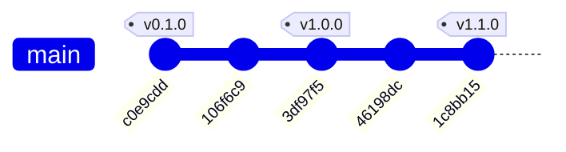

# ⚖️ Mermaid 多引擎即時對比實驗室 (Multi-Engine Comparator)

> 專為比較與評估不同 Mermaid 向量圖形編譯引擎所打造的即時對比工作台。上方即時輸入 Mermaid 語法，下方雙欄即時對照 **Mermaid.js 官方標準引擎** 與 **Obsidian Pele 次毫秒超速引擎**，並內建 Firebase 雲端圖表庫與版本控制演進歷程。

* 🌐 **GitHub 儲存庫**：[https://github.com/renart00001-ux/pele-trial-RA-](https://github.com/renart00001-ux/pele-trial-RA-)
* 🚀 **線上對比展示 (GitHub Pages)**：[https://renart00001-ux.github.io/pele-trial-RA-/](https://renart00001-ux.github.io/pele-trial-RA-/)
* 🚀 **支援引擎**：
  * **引擎 A (左)**：官方標準 `mermaid.js` (v11.4 CDN)
  * **引擎 B (右)**：Obsidian 官方純向量引擎 `pele` (v1.12.0 本地核心)
  * **擴充引擎 (預留)**：底層採用標準化 Render Engine Adapter，可隨時擴充接入 Kroki、PlantUML、Elk 等第三方編譯引擎
* ☁️ **雲端資料庫後台**：Firebase Auth (Google 登入) + Cloud Firestore（個人圖表庫儲存與跨裝置同步）
* 📜 **版本控制**：內建系統視覺化 TimeLine 與 GitHub Pages 自動部署 CI/CD

---

## 🌟 核心功能特色

1. **上方語法即時輸入與多樣化範本**：
   - 提供流程圖 (Flowchart)、Git演進圖 (GitGraph)、時序圖 (Sequence)、心智圖 (Mindmap)、架構圖 (Architecture)、狀態機 (State)、實體關聯圖 (ER) 等一鍵載入。
   - 支援 Tab 鍵縮排、程式碼格式化與清空。
   - 即時圖表類型自動偵測。
2. **下方雙欄圖示即時對照 (Side-by-Side Comparison)**：
   - **預設強制左右並列 (50% : 50%)**：各裝置與螢幕寬度下預設維持對等雙欄並列，精確比對雙引擎線條與節點差異。
   - **多模式版面切換器**：支援「◫ 左右並列」、「☰ 上下排列」與「↔ 寬屏展開 (1720px)」模式，一鍵自由切換並自動持久化記憶。
   - **左欄 Mermaid.js**：呈現官方標準解析與 DOM Layout 成果，確保 100% 語法相容度。
   - **右欄 Obsidian Pele**：呈現次毫秒同步向量渲染，支援 CSS 變數即時換色（完全無須重跑渲染）。
   - **即時效能對決戰報**：精準計算雙引擎解析毫秒數（ms）、SVG 輸出體積（KB）與即時加速比（實測 Pele 領先 100~500 倍！）。
3. **可擴充式多引擎架構設計**：
   - 渲染模組解耦，以標準 `{ id, name, render }` Adapter 模式運作，未來可直接擴充第 3、4 家渲染引擎。
4. **雙畫布同步縮放平移 (Sync Zoom & Pan)**：
   - 提供 50% ~ 300% 同步縮放與 1:1 還原，方便高精度審視細微排版線條。
5. **Firebase 雲端圖庫與跨裝置同步**：
   - 整合 Google 帳號一鍵登入，個人圖表隨時「儲存至雲端」。
   - 提供「我的圖表庫」彈出視窗，隨時檢視歷史圖表、一鍵載入或刪除。
   - 訪客模式下自動支援本機 LocalStorage 快取草稿。
6. **匯出與分享工具**：
   - 支援獨立複製 SVG、下載 `.svg` 向量圖檔，以及一鍵匯出 2x 高解析度 `.png`。
7. **版本控制時間軸與管理員保護**：
   - 頁面常駐詳細版本演進時間軸。
   - 預設收折隱藏，僅授權給管理員帳號（`renart.00001@gmail.com`）登入後展開查閱。

---

## 📈 Git 版本控制演進圖表 (Git Process & Version Flow Chart)



---

## 📜 詳細版本演進歷程 (Version History Table)

| 版本 | 發布日期 | Commit Hash | 核心更新內容與重要成就 |
| :--- | :--- | :--- | :--- |
| **v1.1.0** | 2026-10-27 | `1c8bb15` | ◫ **雙引擎畫布版面配置切換**：預設強制左右並列 (50%:50%)，支援「上下排列」與「寬屏全幅 (1720px)」切換。<br>📱 **防擠壓排版優化**：加入 `min-w-0` 與防溢出捲軸，大圖不變形破版。<br>💾 **版面偏好記憶**：LocalStorage 自動記住使用者的排列與寬屏模式。 |
| **v1.0.0** | 2026-10-27 | `3df97f5` | ⚖️ **雙引擎即時對比實驗室發布**：上方即時語法輸入、下方雙欄對比 (Mermaid.js vs Pele)、次毫秒效能戰報。<br>☁️ **Firebase 後台整合**：Google 帳號登入與 Cloud Firestore 個人圖庫儲存。<br>🔒 **管理員權限折疊**：版控時間軸限 `renart.00001@gmail.com` 展開。 |
| **v0.1.0** | 2026-10-27 | `c0e9cdd` | 💎 **專案初始化**：引入 Obsidian Pele 1.12.0 核心、建立 CLI 工具與效能壓測腳本。 |

---

## 📂 專案目錄架構

```text
pele-trial(RA)/
├── .github/
│   └── workflows/
│       └── deploy-pages.yml   # GitHub Actions 自動部署工作流
├── index.html                 # 主程式 (SPA 雙引擎對比工作台 + Firebase 整合)
├── pele.global.js             # Obsidian Pele 1.12.0 獨立單檔核心 (可 100% 離線)
├── render-cli.mjs             # Node.js 命令列轉譯工具
├── benchmark.mjs              # 效能基準測試工具
├── samples/                   # Mermaid 範例檔與預渲染 SVG
├── package.json               # 專案相依性設定
└── README.md                  # 專案說明與 Git 進程圖表
```

---

## 🌐 遠端 GitHub 儲存庫同步指南

若要在 GitHub 上建立對應之遠端儲存庫：
1. 前往 GitHub [https://github.com/new](https://github.com/new)。
2. 建立新儲存庫，名稱建議為：`pele-trial`（或您偏好的名稱）。
3. 在終端機執行遠端綁定並推播：
   ```bash
   git remote add origin git@github-antigravity:renart00001-ux/pele-trial.git
   git push -u origin main
   ```
